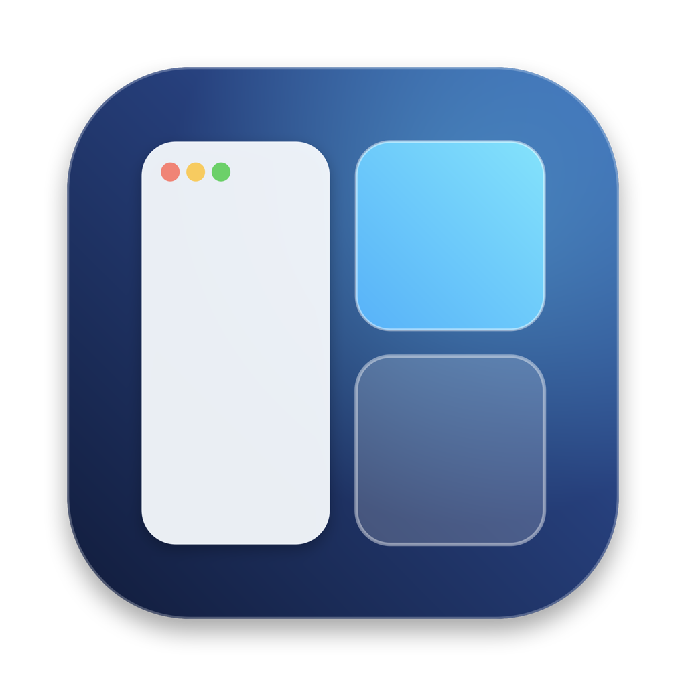

<p align="center">
  
</p>

<h1 align="center">WinMac</h1>

<p align="center">
  <strong>Gestión de ventanas estilo Windows 10/11 (Aero Snap) nativa para macOS en Swift.</strong>
</p>

<p align="center">
  Ligera · Sin dependencias · Vive en la barra de menú · Multi-monitor
</p>

---

## ¿Qué es WinMac?

**WinMac** trae la máquina de estados direccional de ventanas de Windows (`Win + Flechas`) a macOS usando **`Control + Option + Flechas`** (`⌃⌥ + ← ↑ → ↓`).

A diferencia de los gestores clásicos con atajos estáticos por cuadrante, en WinMac las 4 flechas se encadenan de forma natural según el estado actual de la ventana:

- **`⌃⌥ + ←`** desde ventana normal → **Mitad Izquierda**
- **`⌃⌥ + ↑`** desde Mitad Izquierda → **Cuadrante Superior Izquierdo (1/4)**
- **`⌃⌥ + ↓`** desde Cuadrante Superior Izquierdo → vuelve a **Mitad Izquierda (1/2)**
- **`⌃⌥ + ↓`** otra vez → **Cuadrante Inferior Izquierdo (1/4)**
- **`⌃⌥ + →`** desde Mitad Izquierda → **Restaura a Flotante** (y otro `⌃⌥ + →` la pasa a **Mitad Derecha**)

## Tabla de Atajos

| Atajo | Acción |
| :--- | :--- |
| `⌃⌥ + ←` / `⌃⌥ + →` | Mitad izquierda/derecha → Restaurar a flotante → Saltar al monitor adyacente |
| `⌃⌥ + ↑` | Cuadrante superior (desde mitad) / Maximizar (desde flotante o cuadrante superior) |
| `⌃⌥ + ↓` | Volver a mitad (desde cuadrante superior) / Cuadrante inferior (desde mitad) / Restaurar (desde maximizada) / Minimizar al Dock |
| `⌃⌥ + ⌫` | Restaurar tamaño y posición original |
| `⌃⌥ + C` | Centrar ventana en pantalla |

## Instalación

1. Descarga `WinMac.dmg` o `WinMac.zip` desde la sección de [Releases](https://github.com/josechkonn/WinMac/releases).
2. Arrastra **WinMac.app** a `/Applications`.
3. Abre **WinMac** y concede el permiso de **Accesibilidad** en *Ajustes del Sistema → Privacidad y seguridad → Accesibilidad*.

> **Nota:** Si macOS bloquea la app por no estar notarizada con cuenta paga de Apple Developer, ejecuta una vez:
> ```bash
> xattr -cr /Applications/WinMac.app
> ```

## Compilar desde código fuente

Requisitos: macOS 14+ y Swift 6 / Xcode Command Line Tools.

```bash
git clone https://github.com/josechkonn/WinMac.git
cd WinMac
swift test
./scripts/build_app.sh
cp -R dist/WinMac.app /Applications/WinMac.app
open /Applications/WinMac.app
```

## Arquitectura

- **`WinMacCore`**: máquina de estados pura (`SnapStateMachine`) y modelos (`SnapModels`) con pruebas unitarias en Swift Testing (`WinMacCoreTests`).
- **`AXWindowController`**: control nativo por `AXUIElement` con soporte para `AXEnhancedUserInterface` (Electron/Chromium/Safari) y verificación de redimensionado.
- **`ScreenService`**: traducción de coordenadas Cocoa ↔ CoreGraphics/AX y navegación multi-monitor.
- **`HotkeyManager`**: registro de atajos globales vía Carbon (`RegisterEventHotKey`).
- **`AppDelegate`**: app de barra de menú (`LSUIElement = true`) con inicio automático vía `SMAppService`.

## Licencia

MIT © 2026 Jose Chacon
